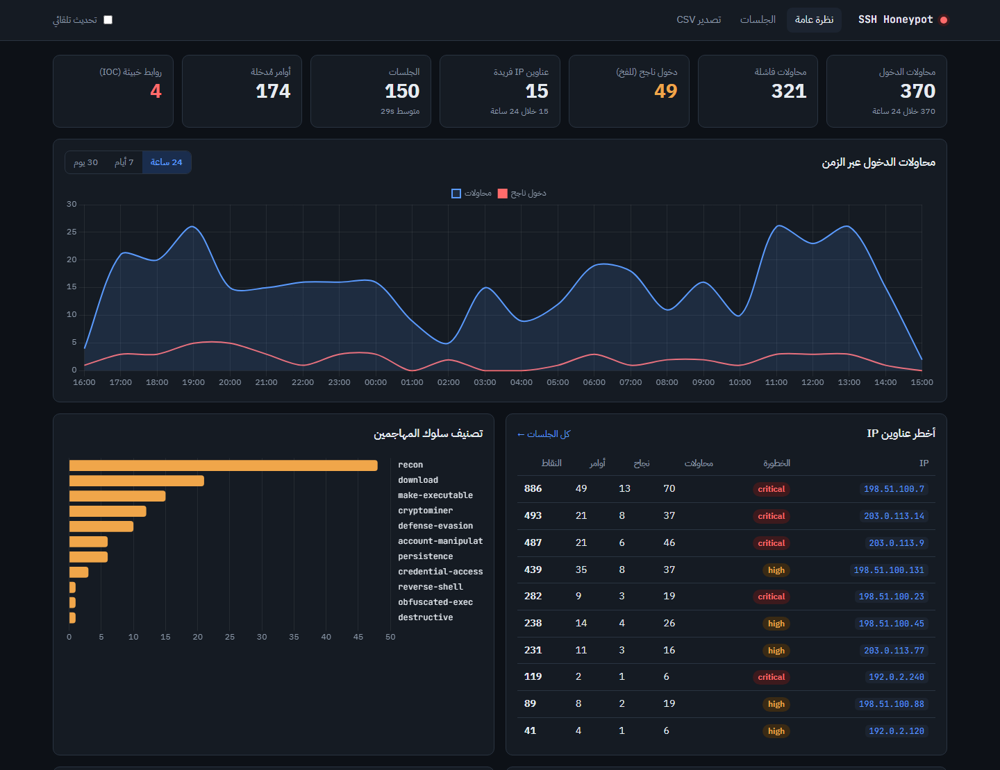

<div dir="rtl">

# 🍯 SSH Honeypot

**خادم SSH وهمي منخفض التفاعل مع تقييم للتهديدات ولوحة تحليلات مباشرة.**

يستدرج البوتات والمهاجمين إلى خادم Ubuntu مزيّف، ويسجّل كل كلمة مرور وكل أمر يجربونه، ثم يحوّلها إلى معلومات تهديد قابلة للاستخدام — **دون تنفيذ أي أمر حقيقي على الإطلاق.**

[English](README.md) · [المعمارية](docs/ARCHITECTURE.md) · [دليل النشر الآمن](docs/DEPLOYMENT.md)

> ⚠️ **للأبحاث الدفاعية والتعليم فقط.** شغّله فقط على جهاز معزول تملكه.

---

## ✨ المميزات

### محرك الخداع (Paramiko)
- بانر OpenSSH 8.9 / Ubuntu 22.04 مقنع، ورسالة ترحيب، ومفتاح Host **ثابت**
- يلتقط **كل** محاولة دخول بكلمة مرور وكل مفتاح عام (بصمة SHA256)، ناجحة كانت أم فاشلة
- سياسة دخول قابلة للتغيير: قائمة محددة، أو المحاولة رقم N، أو قبول الكل، أو رفض الكل
- طرفية bash مزيفة بنظام ملفات في الذاكرة ونحو 100 أمر، مع دعم **الـ pipes**
  (`cat /proc/cpuinfo | grep name | wc -l` ← `4`) والتوجيه (`>`, `2>/dev/null`) والمتغيرات
- يفك تشفير `echo … | base64 -d | sh` ويحلل الـ payload المخفي

### معلومات التهديد
- نقاط خطورة لكل أمر وتصنيفات مربوطة بـ **MITRE ATT&CK**
- استخراج IOCs: روابط البرمجيات الخبيثة، عناوين C2، محاولات الـ tunneling — تُسجَّل **ولا يُتصل بها أبداً**
- ترتيب الـ IPs حسب الخطورة (`low` ← `critical`)
- ملف أحداث JSONL جاهز لـ ELK / Splunk / Wazuh

### لوحة التحكم (Flask)
- مؤشرات رئيسية، خط زمني (24 ساعة / 7 أيام / 30 يوم)، أخطر IPs، أكثر كلمات المرور والمستخدمين والأوامر
- إعادة تشغيل الجلسة كما كتبها المهاجم، وملف كامل لكل مهاجم
- واجهة JSON وتصدير CSV آمن
- واجهة عربية RTL مع وضع فاتح/داكن تلقائي

### آمن بالتصميم
- الطرفية محاكاة بحتة: لا `subprocess`، لا ملفات حقيقية، لا اتصال شبكة
- رفض Port forwarding و SFTP، حدود للاتصالات لكل IP وإجمالاً، ومهلات زمنية
- اللوحة: اتصال قراءة فقط بالقاعدة، CSP صارم، Basic Auth، وترفض العمل علناً بلا كلمة مرور
- حاوية Docker بمستخدم غير root ونظام ملفات للقراءة فقط وبلا صلاحيات

---

## 🚀 التشغيل السريع

### Windows (PowerShell)

```powershell
git clone https://github.com/Youssef840/ssh-honeypot.git
cd ssh-honeypot
python -m venv .venv
.\.venv\Scripts\Activate.ps1
pip install -e ".[dev]"
copy .env.example .env
```

### Linux / macOS

```bash
git clone https://github.com/Youssef840/ssh-honeypot.git
cd ssh-honeypot
python3 -m venv .venv && source .venv/bin/activate
pip install -e ".[dev]"
cp .env.example .env
```

### تجربة بأمر واحد

يشغّل الفخ، ويملؤه ببيانات هجمات واقعية، ويفتح اللوحة في المتصفح:

```bash
python scripts/demo.py
```



### التشغيل اليدوي (نافذتان)

```bash
python -m honeypot             # الفخ على 127.0.0.1:2222
python -m honeypot.dashboard   # اللوحة على http://127.0.0.1:5000
```

### جرّب الهجوم بنفسك

```bash
ssh -p 2222 root@127.0.0.1                       # كلمة المرور: root
python scripts/simulate_attack.py --rounds 5     # أو ولّد بيانات تجريبية
```

### الاختبارات

```bash
ruff check .
pytest --cov
```

### Docker

```bash
cp .env.example .env          # اضبط DASH_PASSWORD أولاً
docker compose up -d --build
```

---

## ⚙️ الإعدادات الأهم

| المتغير | الافتراضي | الوصف |
|---|---|---|
| `HP_BIND_HOST` | `127.0.0.1` | `0.0.0.0` فقط على جهاز معزول |
| `HP_PORT` | `2222` | منفذ الفخ |
| `HP_AUTH_MODE` | `list` | `list` / `after_n` / `any` / `never` |
| `HP_ACCEPTED_CREDS` | `root:root,…` | بيانات الدخول المقبولة (`user:*` = أي كلمة مرور) |
| `HP_RETENTION_DAYS` | `0` | حذف الجلسات الأقدم من N يوم تلقائياً |
| `DASH_PASSWORD` | فارغ | إلزامي إذا لم تكن اللوحة على localhost |

القائمة الكاملة في [`.env.example`](.env.example)، أو شغّل:

```bash
python -m honeypot --check-config
```

---

## 🛡️ قبل النشر على الإنترنت

اقرأ [docs/DEPLOYMENT.md](docs/DEPLOYMENT.md) كاملاً. باختصار:
1. جهاز VPS أو VM معزول فقط.
2. انقل SSH الحقيقي إلى منفذ آخر واجعله بالمفاتيح فقط.
3. وجّه المنفذ 22 إلى 2222 عبر iptables، وشغّل الفخ كمستخدم عادي.
4. لا تفتح اللوحة للعموم؛ استخدم نفق SSH.
5. اضبط `HP_RETENTION_DAYS` واحمِ البيانات الملتقطة.

---

## 📄 الرخصة

[MIT](LICENSE)

</div>
