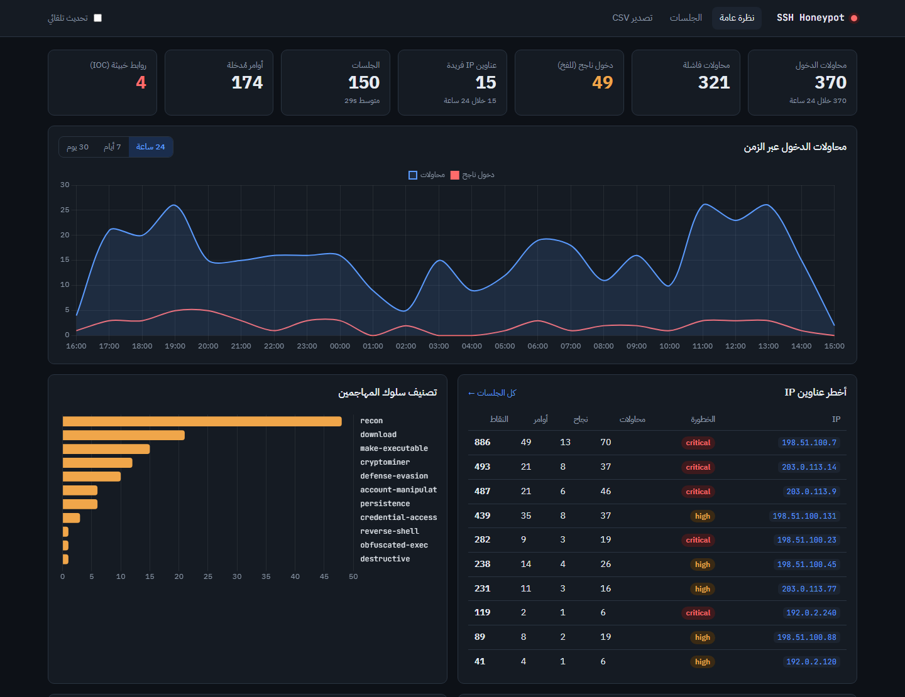
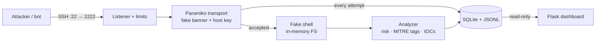
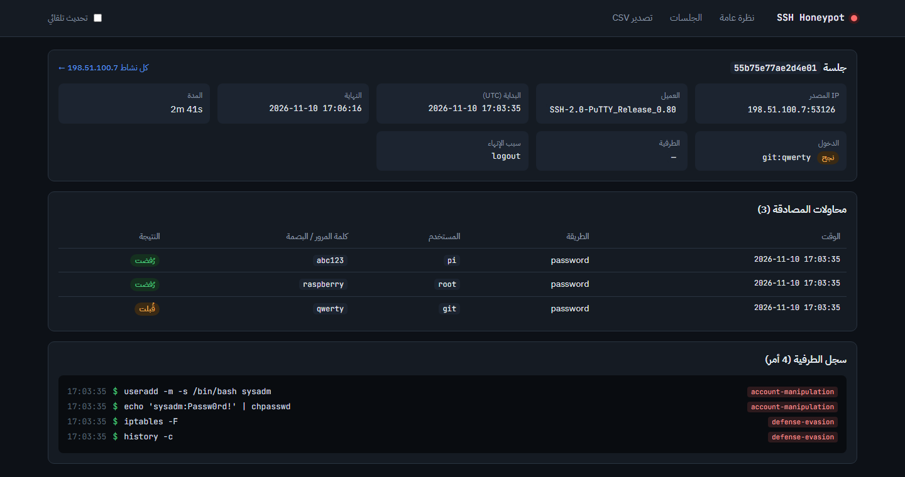

<div align="center">

# 🍯 SSH Honeypot

**A low-interaction SSH honeypot with threat scoring and a live analytics dashboard.**

Lure bots and attackers into a fake Ubuntu server, record every credential and command they try,
and turn it into actionable threat intelligence — without ever running a single real command.

[](https://github.com/Youssef840/ssh-honeypot/actions/workflows/ci.yml)
[](https://github.com/Youssef840/ssh-honeypot/actions/workflows/codeql.yml)

[](LICENSE)
[](https://github.com/astral-sh/ruff)

[Features](#-features) · [Quick start](#-quick-start) · [Architecture](docs/ARCHITECTURE.md) · [Deployment](docs/DEPLOYMENT.md) · [العربية](README.ar.md)



</div>

---

> [!WARNING]
> This project is for **defensive security research and education**. A honeypot is designed to be attacked —
> deploy it only on isolated infrastructure you own, following [docs/DEPLOYMENT.md](docs/DEPLOYMENT.md).

## ✨ Features

**Deception engine (Paramiko)**
- Convincing OpenSSH 8.9 / Ubuntu 22.04 banner, MOTD and a **persistent host key**
- Captures **every** password attempt and public-key offer (SHA256 fingerprint), successful or not
- Pluggable auth policy: accept a credential list, the N-th attempt, everything, or nothing
- Fake bash with an in-memory file system and ~100 commands, including **pipelines**
  (`cat /proc/cpuinfo | grep name | wc -l` → `4`), redirections and `$VAR` expansion
- Decodes `echo … | base64 -d | sh` droppers and analyses the hidden payload

**Threat intelligence**
- Per-command risk score and behaviour tags mapped to **MITRE ATT&CK** (reverse shell, cryptominer,
  persistence, defense evasion…)
- IOC extraction: malware URLs, C2 IPs, tunnelling attempts — recorded, **never contacted**
- Behaviour-based threat level per source IP (`low` → `critical`): a loud brute-forcer never outranks an attacker who got in and launched a miner
- JSON-lines event feed ready for ELK / Splunk / Wazuh

**Dashboard (Flask)**
- KPIs, 24 h / 7 d / 30 d attack timeline, top IPs, passwords, usernames, combos and commands
- Session replay and per-attacker profile pages
- JSON API and formula-injection-safe CSV export
- Arabic RTL interface with automatic light/dark theme

**Hardened by design**
- The shell is a pure emulator — no `subprocess`, no real file I/O, no outbound network
- Port forwarding / SFTP refused; per-IP and global connection caps; auth, idle and session timeouts
- Dashboard: read-only DB connection, strict CSP, autoescaping, Basic Auth, refuses public binding without a password
- Docker image runs as non-root with a read-only filesystem and zero Linux capabilities

## 🚀 Quick start

```bash
git clone https://github.com/Youssef840/ssh-honeypot.git
cd ssh-honeypot
python -m venv .venv && source .venv/bin/activate   # Windows: .\.venv\Scripts\Activate.ps1
pip install -e ".[dev]"
cp .env.example .env                                 # Windows: copy .env.example .env
```

**One-command demo** — starts the honeypot, fills it with realistic attack traffic and opens the dashboard:

```bash
python scripts/demo.py
```

Or run the honeypot and the dashboard yourself in two terminals:

```bash
python -m honeypot             # SSH honeypot on 127.0.0.1:2222
python -m honeypot.dashboard   # dashboard on http://127.0.0.1:5000
```

Attack it yourself (password `root`), or generate demo traffic:

```bash
ssh -p 2222 root@127.0.0.1
python scripts/simulate_attack.py --rounds 5
```

### Docker

```bash
cp .env.example .env          # set DASH_PASSWORD first
docker compose up -d --build  # honeypot on :22, dashboard on 127.0.0.1:5000
```

## 🧭 How it works



Full design notes, data model and threat-scoring formula: **[docs/ARCHITECTURE.md](docs/ARCHITECTURE.md)**.

**Session replay** — every command an attacker typed, tagged with the behaviour it represents:



## ⚙️ Configuration

All settings are environment variables (or `.env`). The most important:

| Variable | Default | Description |
|---|---|---|
| `HP_BIND_HOST` | `127.0.0.1` | Listen address — use `0.0.0.0` only on an isolated host |
| `HP_PORT` | `2222` | Listen port |
| `HP_AUTH_MODE` | `list` | `list` · `after_n` · `any` · `never` |
| `HP_ACCEPTED_CREDS` | `root:root,…` | Credentials accepted in `list` mode (`user:*` = any password) |
| `HP_SSH_BANNER` | `SSH-2.0-OpenSSH_8.9p1 Ubuntu-3ubuntu0.6` | Version string shown to clients |
| `HP_RETENTION_DAYS` | `0` | Auto-delete sessions older than N days (0 = keep) |
| `DASH_PASSWORD` | *(empty)* | Dashboard Basic Auth — required for non-loopback binding |

See [`.env.example`](.env.example) for the full list, or run `python -m honeypot --check-config`.

## 🔌 API

| Endpoint | Returns |
|---|---|
| `GET /api/summary` | Totals (attempts, logins, IPs, commands, IOCs) |
| `GET /api/timeline?hours=168` | Attempts per hour/day |
| `GET /api/top-ips?limit=20` | Ranked attackers with score and threat level |
| `GET /api/top/{username\|password\|combos\|commands}` | Top-N lists |
| `GET /export/auth.csv` | All authentication attempts |
| `GET /healthz` | Liveness probe (no auth) |

## 🧪 Testing

```bash
ruff check .
pytest --cov
```

The suite includes an end-to-end test that boots a real honeypot on a random port, attacks it over SSH
with Paramiko, and asserts that credentials, commands, decoded payload IOCs and refused tunnels are recorded.
CI runs it on Linux and Windows for Python 3.10–3.13.

## 📁 Project structure

```
honeypot/
├── server.py        # Paramiko engine: listener, auth capture, session handling
├── fake_shell.py    # bash emulator + in-memory file system
├── analysis.py      # risk rules, MITRE ATT&CK tags, IOC extraction
├── database.py      # SQLite schema, thread-safe writer, JSONL feed, retention
├── config.py        # validated settings from env / .env
├── cli.py           # `python -m honeypot` / `python -m honeypot.dashboard`
└── dashboard/       # Flask app, queries, templates, static assets
tests/               # unit + end-to-end tests
scripts/             # demo.py (one-command demo) + simulate_attack.py (loopback only)
docs/                # architecture & deployment guides
```

## 🗺️ Roadmap

- [ ] GeoIP enrichment and world map (MaxMind GeoLite2)
- [ ] Telegram / Discord / Slack alerts on successful logins
- [ ] AbuseIPDB enrichment and automatic reporting
- [ ] Telnet listener for Mirai-family bots
- [ ] Prometheus `/metrics` endpoint

## 🤝 Contributing

Contributions are welcome — see [CONTRIBUTING.md](CONTRIBUTING.md). Please report vulnerabilities privately
as described in [SECURITY.md](SECURITY.md).

## 📄 License

[MIT](LICENSE) © 2026 YOUR NAME

<sub>Inspired by the excellent <a href="https://github.com/cowrie/cowrie">Cowrie</a> project — this is a compact,
readable implementation meant for learning and small deployments.</sub>
